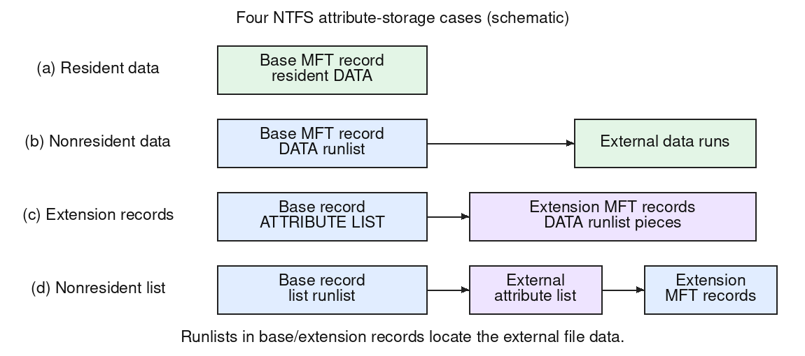

NTFS describes a file using **attributes** in a base **MFT record**. A small attribute value fits inside that record (**resident**). A larger value lives in external clusters (**nonresident**); its attribute record contains a **runlist** mapping logical file ranges to those clusters.

The four useful growth cases are:

1. **Resident file data.** The DATA attribute's bytes fit in the base MFT record along with its other attributes. A read of that record can obtain both metadata and the small file's contents.
2. **Nonresident data with a runlist that still fits.** As the file grows, its data moves to external runs of clusters. The base record retains the runlist describing those runs.
3. **Attributes/runlists need extension records.** If attributes or their retrieval information no longer fit in the base record, allocate additional **MFT records**. An **ATTRIBUTE_LIST** identifies which record holds each attribute or logical range of a split nonresident attribute. DATA runlist pieces remain associated with their attribute records; this is not a mandatory UNIX-style chain of single/double indirect blocks.
4. **The attribute list itself becomes nonresident.** When that list no longer fits in the base record, its contents are stored externally, located through its own nonresident runlist. The list still identifies the extension MFT records containing the file's attributes.

A large but contiguous file may have a short runlist, whereas a smaller fragmented file may need many run descriptions. Thus growth in metadata depends on **fragmentation and attribute sizes**, not just file bytes. These are storage cases, not a universal variable-depth extent tree.

External clarification: Microsoft's [attribute-record format](https://learn.microsoft.com/en-us/windows/win32/devnotes/attribute-record-header) describes retrieval information and extension records; this resolves the earlier explanation's incorrect indirect-extent-list model.
