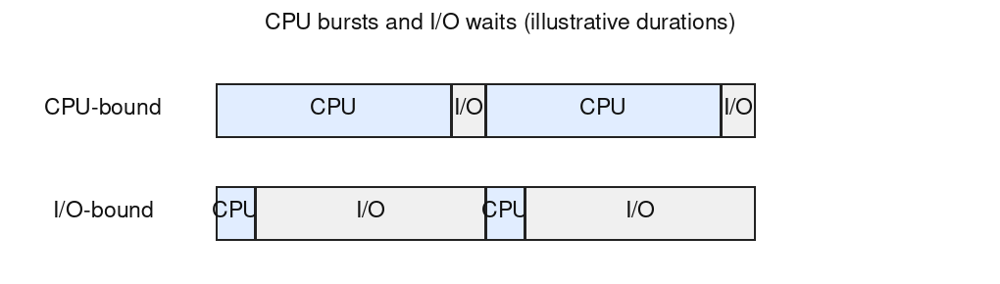

- Compute-bound (CPU-bound): a long CPU burst then a short I/O, repeatedly, the timeline is mostly CPU activity. Limited by CPU speed.
- I/O-bound: a short CPU burst then a long I/O wait, repeatedly, the timeline is mostly device waiting. Limited by device speed.

The durations are illustrative, not values given in the paper. CPU-bound means the CPU is the main bottleneck; it does not require every I/O wait to be short. If CPU execution becomes faster while device latency stays similar, a workload can become relatively more I/O-bound. Simply giving a process more memory or more CPU time does not by itself establish that change.
