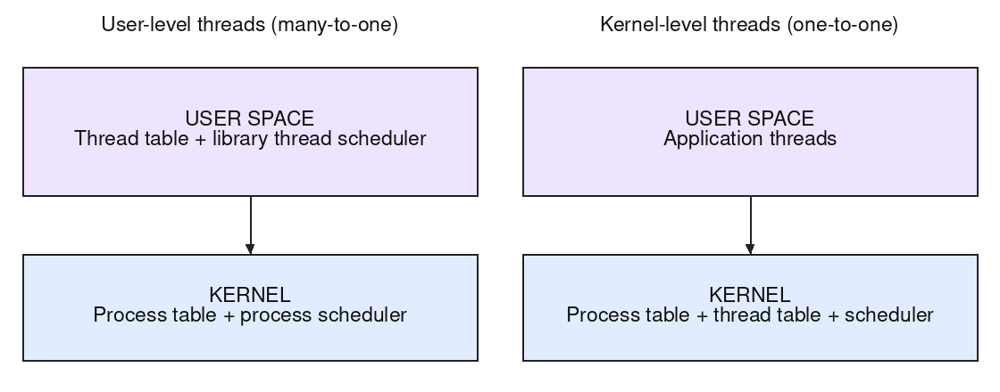

A thread is an independent sequence of instructions, with its own registers and stack. The implementation determines **who knows about these threads and can schedule them**.

**User-level, many-to-one implementation.** A run-time library in each process maintains the thread table and thread scheduler in **user space**. The kernel maintains its process table and process scheduler, but sees only one schedulable entity for this process. Switching between its user threads can therefore be a library operation.

**Kernel-level, one-to-one implementation.** Each application thread corresponds to a kernel-scheduled thread. The **kernel** maintains the thread table and scheduler alongside its process-level bookkeeping. Threads share process resources but have separate scheduling states.

Now let one thread issue a blocking read. In the many-to-one design, the kernel blocks the sole schedulable entity, so all sibling user threads lose the CPU even if they could compute. In the one-to-one design, the kernel blocks **only the caller** and can run another ready sibling. The same distinction matters for a blocking page fault.

This is the classical many-to-one versus one-to-one comparison. A many-to-many hybrid, or a user run-time using nonblocking I/O and kernel cooperation, can avoid some whole-process blocking. "User-level thread" by itself does not mean every modern implementation has the many-to-one limitation.
