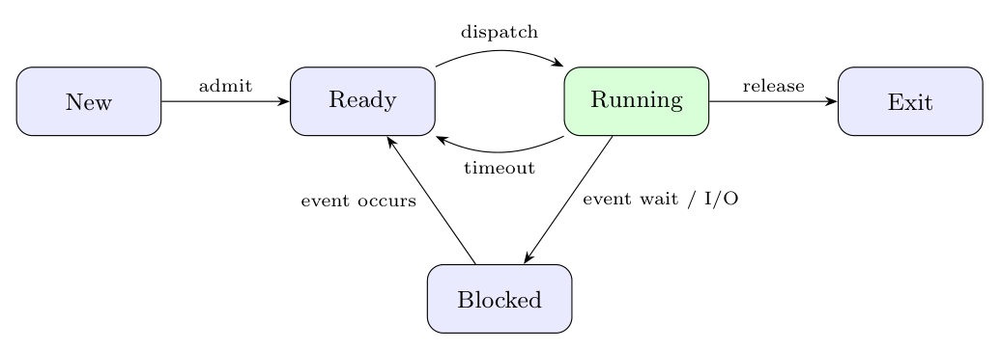

States and transitions: New $\to$ Ready (admitted); Ready $\to$ Running (dispatch); Running $\to$ Ready (time-out / preempt); Running $\to$ Blocked (wait for I/O or event); Blocked $\to$ Ready (event done); Running $\to$ Terminated (exit).

- (i) Starvation: CPU starvation leaves the process **Ready**, repeatedly passed over by the scheduler. Resource starvation can instead leave a process **Blocked** waiting for a resource that is repeatedly granted to others; the question needs this distinction.
- (ii) Livelock: the process continues executing or being scheduled (Running when on the CPU, Ready when preempted), but keeps retrying without making useful progress, e.g. two processes repeatedly backing off and retrying so neither proceeds.
