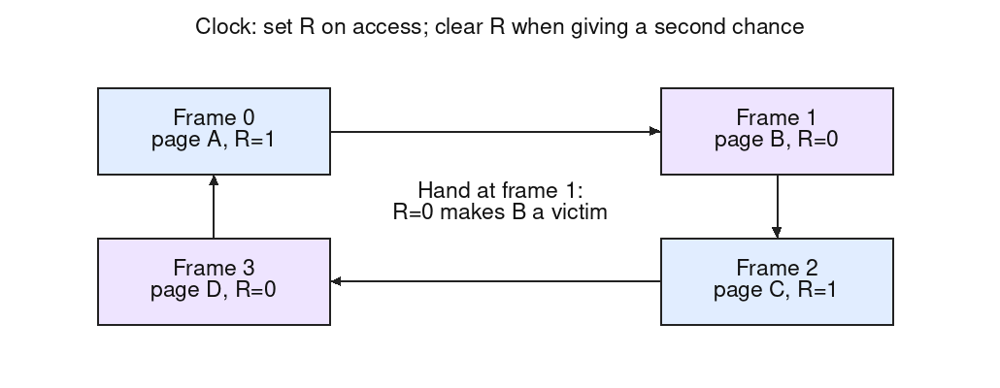

**Limitations of exact LRU.** True LRU needs to know the *exact* order in which all pages were last referenced. Implementing it exactly requires either (a) a timestamp updated by hardware on *every single* memory reference, with the OS having to scan/compare all timestamps to find the minimum at eviction time -- prohibitively slow as memory size grows -- or (b) maintaining a doubly-linked list that is reordered (move-to-front) on every reference, which again is far too expensive to do on every memory access at the granularity a CPU operates at. In short, LRU is a great *policy* but essentially un-implementable exactly in general-purpose hardware at reasonable cost.

**How Clock approximates it.** Clock uses just a single extra *use/reference bit* per page, set automatically by hardware whenever the page is accessed -- vastly cheaper than exact recency tracking. Frames are arranged in a circular list with a "clock hand".

*Steps*:

1.  On a page fault, look at the page currently pointed to by the hand.

2.  If its use bit is $0$, evict it (this page has not been used since the last sweep -- a good approximation of "not recently used").

3.  If its use bit is $1$, give it a "second chance": clear the bit to $0$ and advance the hand to the next frame; repeat from step 1.

4.  Insert the new page at the (now evicted) slot, set its use bit to $1$, and advance the hand.

This approximates LRU because pages that keep getting accessed keep their bit set and survive sweep after sweep, while a page nobody has touched since the hand last passed is evicted -- at $O(1)$ bookkeeping cost per reference without rearranging a recency list on every access. Moving a known list node to the front is already $O(1)$; the difficulty is doing that software work on every memory reference, not an inherent logarithmic list cost.

**Special treatment of dirty pages.** A refined Clock also inspects the dirty/modified bit: pages that are unused *and* clean ($R=0,M=0$) are evicted for free; pages that are unused but dirty ($R=0,M=1$) have their write-back to disk *initiated in the background* rather than being evicted immediately, and are revisited after write-back completes. The OS must not mark a page clean if it was written again while I/O was pending; retain the redirtied state or protect/snapshot the I/O version. If every candidate is awaiting I/O, wait for completion rather than spinning indefinitely.

*Rationale*: evicting a dirty page requires an expensive synchronous disk write before the frame can be reused, stalling the faulting process; evicting a clean page is free (an identical copy is already on disk). By preferring clean victims and pushing dirty pages toward disk ahead of time, the algorithm hides I/O latency and minimizes the cost paid at the moment a frame is actually needed.
