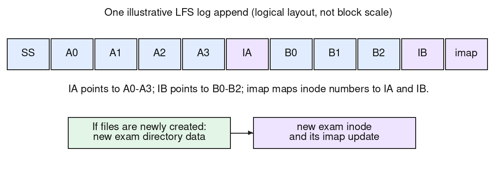

In LFS, changed data and metadata are appended to the log. An inode's new copy points to the new data blocks; the **inode map (imap)** then records the new location of that inode. This extra mapping lets an inode move without rewriting every directory entry that names it.

Assume the seven written blocks and the required inode/imap updates fit in one segment, and ignore indirect-block needs. One valid logical ordering is shown below; exact block packing and ordering within a segment are implementation choices. SS denotes the segment summary.

| Appended item | Meaning |
|:--|:--|
| Segment summary | Identifies the logged file blocks and recovery/cleaning information |
| A0, A1, A2, A3 | Four new blocks of A.txt |
| IA | New A.txt inode, pointing to A0-A3 |
| B0, B1, B2 | Three new blocks of B.txt |
| IB | New B.txt inode, pointing to B0-B2 |
| imap piece(s) | Map A and B's stable inode numbers to IA and IB's new log addresses |

If these are **existing files being rewritten or appended**, their names already exist in `exam`, so the directory's entries need not change merely because IA and IB move. A directory entry stores **name to inode number**, rather than name to the current physical inode address.

If the question intends **newly created files**, also log updated `exam` directory data with `A.txt` and `B.txt` mapped to their inode numbers, a new `exam` inode pointing to that directory block, and its imap update. The checkpoint region later records the current imap-piece locations; it need not be rewritten for every segment. Old superseded blocks remain physically present until the cleaner reclaims them.
